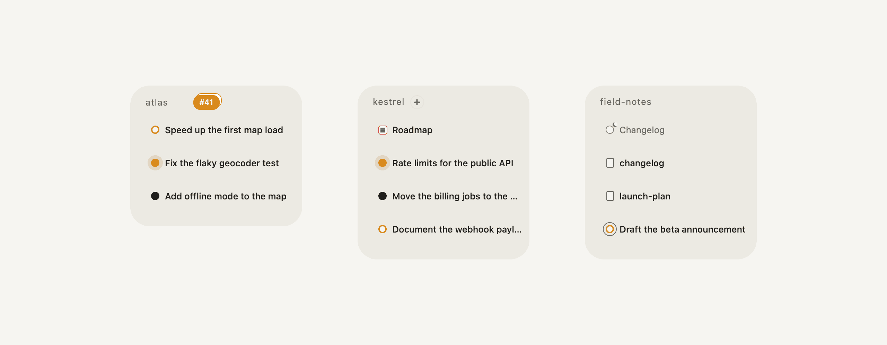
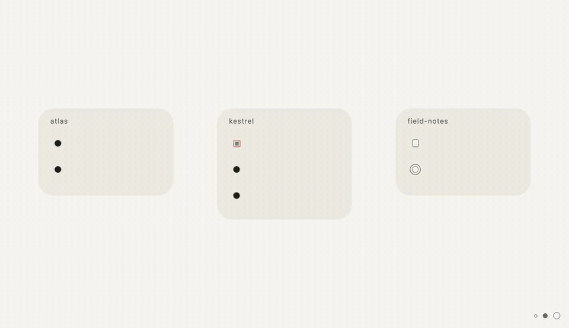
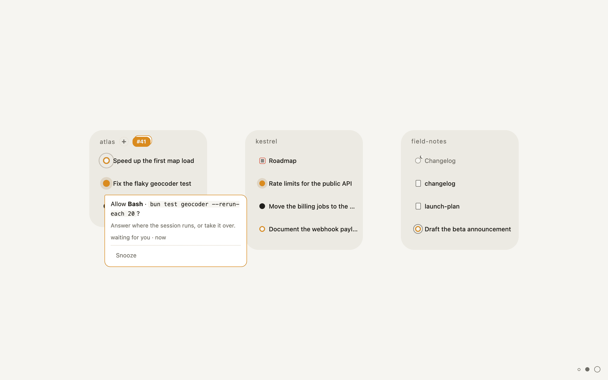
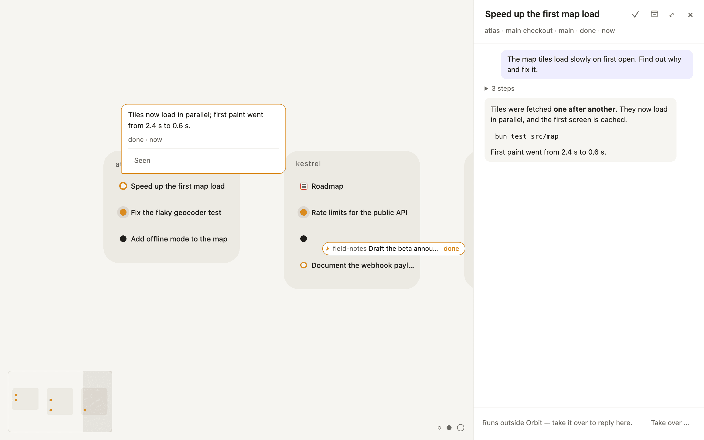
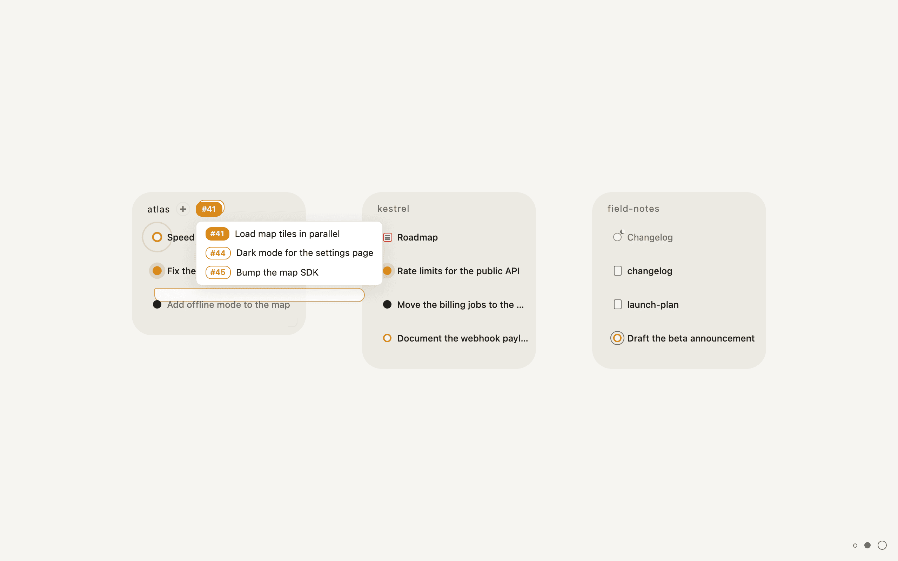
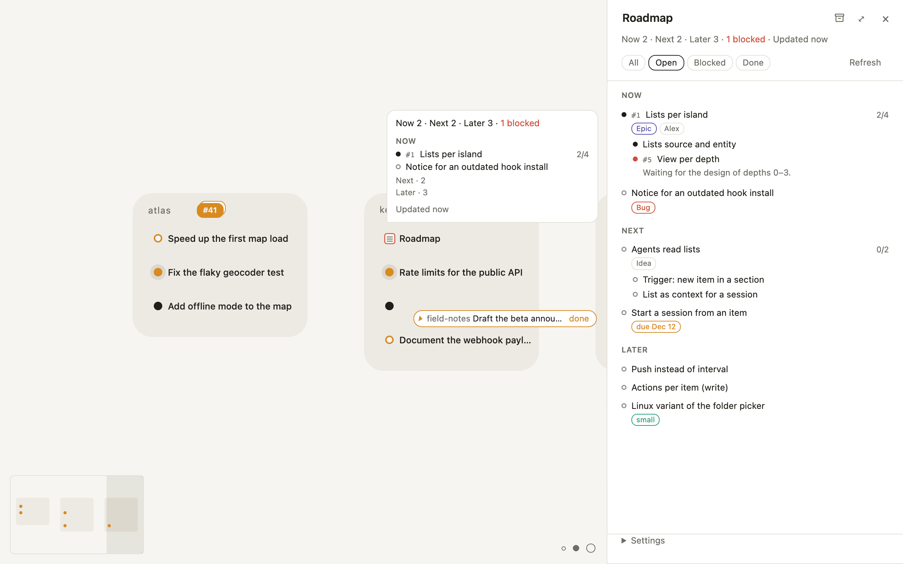

# Orbit

A control centre for AI agents across several workspaces.

<picture>
  <source media="(prefers-color-scheme: dark)" srcset="docs/media/board-dark.png">
  
</picture>

Orbit shows at a glance which Claude Code sessions are working, finished or **waiting for you** — whether they run in VS Code, Conductor or the terminal. No more switching through tabs and windows to check.

Sessions you run yourself stay yours: Orbit only watches them and never types into them. Sessions you start from the board run through Claude Code's own CLI (`claude -p`), and there you reply, allow tool use and answer questions right on the board ([ADR-0010](docs/adr/0010-observed-and-owned-sessions.md), [ADR-0019](docs/adr/0019-owned-sessions-via-claude-cli.md)).

## Quick start (macOS)

Requirements: [Bun](https://bun.sh) ≥ 1.1, Git, Claude Code. Optional: the [GitHub CLI](https://cli.github.com) `gh`, logged in, for pull requests (without it, set `ORBIT_GITHUB=0`).

```bash
git clone https://github.com/mbernath/orbit.git
cd orbit
bun install
bun run hooks:install   # adds the hooks globally to ~/.claude/settings.json (with backup)
bun start               # board at http://127.0.0.1:4747
```

Restart running Claude Code sessions once so they load the hooks. On the first start the board suggests your most recent project folders as islands; one click adds one.

Remove the hooks again: `bun run hooks:uninstall`

### What the hook installer changes

`bun run hooks:install` touches exactly one file, Claude Code's global `~/.claude/settings.json` (override with `CLAUDE_SETTINGS=<path>`):

- **Backup first:** the current file is copied to `~/.claude/settings.json.orbit-backup-<timestamp>` before anything is written.
- **Adds one command hook** — the absolute path to `hooks/orbit-hook.sh` in your clone — for seven events: `SessionStart`, `UserPromptSubmit`, `PermissionRequest`, `PostToolUse`, `Notification`, `Stop`, `SessionEnd`. Each becomes its own entry next to your existing hooks:

  ```json
  "hooks": {
    "Stop": [
      { "hooks": [{ "type": "command", "command": "/path/to/orbit/hooks/orbit-hook.sh" }] }
    ]
  }
  ```

- **Leaves everything else alone:** other settings and other hooks stay as they are. Running it twice adds nothing twice — Orbit entries (recognised by `orbit-hook.sh` in the command) are replaced, not duplicated. `hooks:uninstall` removes only those entries.
- **Moving the clone** breaks the path: run `bun run hooks:install` again from the new place. If an update of Orbit needs a new event, the board shows a notice asking you to re-run the installer ([ADR-0031](docs/adr/0031-stale-hook-install-notice.md)).

What the hook does on each event: it reads the event JSON Claude Code passes on stdin, adds the Git common dir, checkout root and branch of the session's folder, and posts it with the token from `~/.orbit/hook-token` to `http://127.0.0.1:4747/events` (`ORBIT_URL` overrides). That JSON includes what Claude Code puts into hook events — e.g. your prompt, tool names and tool inputs — and it goes **only to your local Orbit server**, never elsewhere. The hook sends in the background and exits at once with code 0, so it never blocks or fails a Claude session, even when Orbit is not running. Orbit only listens: it never answers a hook with a decision, so permission dialogs stay in VS Code or the terminal.

The server only accepts requests from the board and the hook: it checks host and origin, the board receives a token with the page, and the hook reads its token from `~/.orbit/hook-token` (written on first start). After a server restart, an open board tab needs a reload.

## How it works

```
Claude Code (VS Code / Conductor / terminal)
   │  hooks: SessionStart · UserPromptSubmit · PermissionRequest · PostToolUse · Notification · Stop · SessionEnd
   ▼
hooks/orbit-hook.sh  ──POST /events──►  Orbit server (Bun + SQLite, localhost only)
                                              ▲              │
         ~/.claude/projects/*.jsonl ──import──┘              ▼
         (existing sessions, read-only)               board in the browser
```

| Hook | Status on the board |
|---|---|
| `SessionStart` | ready |
| `UserPromptSubmit` | working |
| `PermissionRequest` | **waiting for you**, with the concrete question (permission, question or plan) — read only, the dialog stays in Claude Code |
| `PostToolUse` | working again once the asked tool ran; `TodoWrite` updates the progress |
| `Notification` | **waiting for you** |
| `Stop` | done, with the last answer as preview |
| `SessionEnd` | inactive |

The hook never blocks Claude: it sends in the background (two-second timeout) and always exits at once with code 0, even when Orbit is not running.

**Existing sessions** are imported from Claude Code's transcripts (`~/.claude/projects`) on server start and whenever a workspace is added. They appear as *inactive*; once such a session sends hook events again (e.g. after `claude --resume`), it is live again. Orbit only reads the transcripts, it never writes to them ([ADR-0003](docs/adr/0003-import-existing-transcripts.md)).

**Session titles** are the topic titles Claude Code writes into the transcript — the same names the VS Code history shows. Until Claude has named a session, its first prompt stands in. Rename one in its panel or with F2 ([ADR-0004](docs/adr/0004-card-titles-and-canvas-positions.md)).

## The board

Every workspace is an **island** on one infinite canvas; sessions are dots with their name. Drag the background to pan, pinch or ⌘/Ctrl + scroll to zoom: the further in, the more each dot shows — a bubble with its last words, the waiting question, its pull request. Orange means it needs you: waiting, done, CI red or ready to merge. **W** jumps to the next one, **Enter** opens it in the detail panel, **?** lists every key. Drag dots to arrange them; positions are stored, and nothing rearranges itself.



<table>
  <tr>
    <td width="50%"><picture><source media="(prefers-color-scheme: dark)" srcset="docs/media/waiting-dark.png"></picture><br><sub><b>Waiting for you</b> — orange dots, the request right in the bubble.</sub></td>
    <td width="50%"><picture><source media="(prefers-color-scheme: dark)" srcset="docs/media/panel-dark.png"></picture><br><sub><b>Detail panel</b> — the conversation, steps folded.</sub></td>
  </tr>
  <tr>
    <td width="50%"><picture><source media="(prefers-color-scheme: dark)" srcset="docs/media/prs-dark.png"></picture><br><sub><b>Pull requests</b> — ready to merge or waiting for your review.</sub></td>
    <td width="50%"><picture><source media="(prefers-color-scheme: dark)" srcset="docs/media/list-dark.png"></picture><br><sub><b>Lists</b> — a script's output as a node on its island.</sub></td>
  </tr>
</table>

The **"+"** beside an island's name adds to it: a new session Orbit runs for you (**N**), an agent, a Markdown file or a list. **Clicking the island name** opens the island itself: its folders, the defaults for new sessions, and clean-up — remove done or inactive sessions from the board, tidy the island, and bring back what was removed ([ADR-0042](docs/adr/0042-island-panel-and-add-menu.md)).

Inactive sessions (ended or imported) stay on the board until you remove them. Removed ones stay in the island panel and come back with a click; a session that becomes active again returns on its own. Orbit never deletes transcripts — Claude Code purges those itself after `cleanupPeriodDays` ([ADR-0005](docs/adr/0005-inactive-and-archive.md)).

## Markdown files

"Pin file …" lists the Markdown files in your workspaces (hidden and build folders skipped). A pinned file appears as a document on the canvas, rendered, with a badge showing whether it is checked into its repo. Open it in the panel to read and edit it; saving only succeeds if the file has not changed on disk in the meantime — otherwise you choose between saving your version and discarding it. Changes by agents or editors show up within two seconds. Only `.md` files inside workspace folders can be opened, never anything in `.git` or `~/.claude` ([ADR-0011](docs/adr/0011-markdown-files.md)).

## Pull requests

For every GitHub repo inside a workspace (the folder itself or up to two levels below), Orbit follows the open pull requests with CI state and whether they can be merged. A session working on a PR's branch shows a chip with the PR number; PRs without a session on the board show as a pill beside the island's name ([ADR-0038](docs/adr/0038-island-pr-pill.md)). Red CI and mergeable PRs turn the session orange. Mergeable PRs can be merged from the board after a confirmation (squash and delete branch preselected), or handed to the session to fix and merge. Everything runs through your logged-in `gh` CLI; Orbit stores no token ([ADR-0006](docs/adr/0006-github-via-gh.md)).

## Workspaces

A workspace is a **folder**. It can be a Git repo, contain several repos or none at all, e.g. for concepts, client projects or research. Create workspaces on the board (double-click free space) or directly in `~/.orbit/workspaces.json`:

```json
[
  { "id": "customer-portal", "name": "Customer portal", "paths": ["~/Projects/customer-portal"] },
  { "id": "concepts", "name": "Concepts", "paths": ["~/Concepts", "~/Documents/Ideas"] }
]
```

Sessions are assigned by their path; the longest matching path wins. **Git worktrees** (e.g. from Conductor) land in the workspace of their main repo, because the hook sends the shared `.git` directory along. Sessions without a matching workspace appear under "No island".

Tip: give every workspace a `CLAUDE.md` and context files (audience, decisions, status). That replaces project knowledge in Claude.ai, but is versioned and directly editable.

## Configuration

| Variable | Default | Purpose |
|---|---|---|
| `ORBIT_PORT` | `4747` | Server port |
| `ORBIT_HOME` | `~/.orbit` | Database and `workspaces.json` |
| `ORBIT_URL` | `http://127.0.0.1:4747` | Target of the hook |
| `ORBIT_GITHUB` | `1` | `0` disables all GitHub calls |

## Privacy

The server listens on `127.0.0.1` only; there is no Orbit cloud and no telemetry. Stored in `~/.orbit/orbit.db`: session ID, path, branch, status, title, the first prompt (truncated), the last answer (truncated), positions on the board and archive state. Run defaults and drafts of replies live in the browser or the database, never anywhere else. The GitHub integration only asks GitHub about your repos through `gh`; it sends nothing from Orbit's data.

## Roadmap

- [x] **Stage 1: Observe.** Status of all sessions, what needs you, workspaces as islands, import of existing sessions.
- [ ] **Stage 2: Context.** ~~Canvas view with freely arrangeable cards~~ (done). Memory files per workspace (audience, decisions, status) shown and editable in the board.
- [ ] **Stage 3: Respond.** Answer from the board, also by voice ("@Kundenportal, take direction two"). Via Claude Code channels or own sessions with the Agent SDK.
- [ ] **Stage 4: Connect.** Let agents talk to each other through a mailbox (MCP), shared memory, inputs from mail, WhatsApp and other sources through a router with a sender whitelist.

### Before sharing Orbit

- [x] No personal names in code and docs; personal agreements live in a gitignored `CLAUDE.local.md`.
- [x] Board and messages in English, no i18n; terms in `docs/design/copy.md` ([ADR-0039](docs/adr/0039-english-product-language.md)).
- [ ] README quickstart: prerequisites, install, hooks, start, uninstall — basics done, check it once on a clean machine.
- [x] Before handing out: a fresh clone passes `bun run verify` and the browser tests (checked 2026-11-26).
- [x] Hook transparency: the README says what is written to `~/.claude/settings.json` and what the hook sends where.
- [x] Licence: MIT with Commons Clause.
- [x] Check git history for secrets and private paths — no secrets; private names scrubbed from the current tree, history left as is.
- [ ] Empty-board start screen and gradual onboarding (design spec first; where dismissed hints are stored needs an ADR).
- [x] Tidy the "+" menu: it only adds; the island itself has a panel ([ADR-0042](docs/adr/0042-island-panel-and-add-menu.md)).
- [x] Nicer dialogs: one shared dialog component (ADR-0042).
- [ ] Changelog and update path (`git pull`, migrations).
- [ ] Issue template for feedback.

## Development

```bash
bun run dev   # server with auto-reload
bun test      # tests
bun run verify  # type check + tests, before every commit
bunx playwright install chromium  # once, for the browser tests
bun run test:e2e  # browser tests (Playwright), each with its own throwaway server
bun run fresh   # throwaway Orbit on port 4748 with an empty data folder, to try the first run
bun run fresh --demo  # the same, plus simulated live sessions in your most recent folder
bun run media   # renders the README's screenshots and tour into docs/media from a made-up demo board (needs ffmpeg, pngquant)
```

Architecture decisions are recorded in [docs/adr/](docs/adr/).

## License

[MIT with the Commons Clause](LICENSE): use, change and share Orbit freely, also at work and in paid projects — but do not sell Orbit itself, or a product, hosting or support service whose value comes substantially from it.
